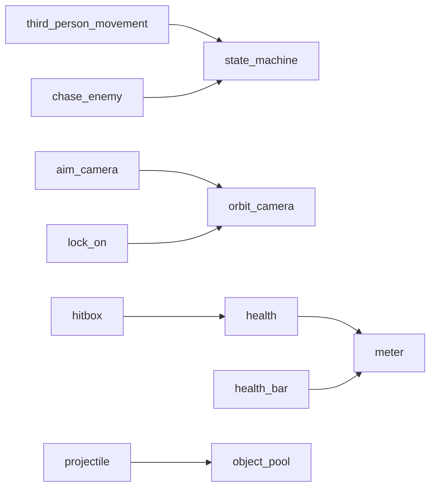

# How the recipes fit together

Each recipe is a folder that works on its own, and most games use several at once. This page collects what crosses recipe boundaries: which recipes need which, and the conventions they share without importing each other. The rules for a single recipe are in the [recipe contract](recipe_contract.md).

## Dependencies

An arrow means "is copied along with": `tools/cookbook add` takes the recipe at the arrow's tail and everything it points to. These are the `depends` lists in each `recipe.cfg`.

The other recipes depend on nothing: `first_person_movement`, `moving_platform`, `checkpoint`, `interaction`, `inventory`, `pause_menu`, `settings_menu`, `save_load` and `scene_transition`.

Everything else recipes do for each other goes through the conventions below, which are looked up by name at run time. A recipe that offers one works without the recipe that uses it, and the other way round.

## Conventions

| Convention | Offered by | Used by | What it means |
|---|---|---|---|
| Group `saveable`, with `save_data()`, `load_data(data)` and optional `load_missing()` | `Meter`, `Health`, `Inventory`, `Pickup`, `Respawner`, both characters, `SaveTransform` | `SaveGame` (`save_load`) | The node's state is written to a save and restored from it. Details: "Saveable nodes" in the [recipe contract](recipe_contract.md). |
| Method `teleport(transform)` | `ThirdPersonCharacter`, `FirstPersonCharacter` | `Respawner` (`checkpoint`), `SaveTransform` (`save_load`) | Puts the character somewhere new and lets it clean up: stop, leave a dash, face the transform's direction, reset interpolation. A body without the method is only moved. |
| Group `player` | Your player node. No recipe adds it; the demos do. | `ChaseEnemy`, when its `target` is not set (`target_group`) | Who the enemy chases. |
| Group `lock_on_targets` | `LockOnTarget` | `LockOn` | What can be locked onto. |
| Group `respawners` | `Respawner` | `Checkpoint` | Finds the respawner of the body that walked in. |
| `OrbitCamera.snap_to_target()` | `orbit_camera` | Your code, after teleporting what the camera follows, for example from `Respawner.respawned` | The camera jumps instead of easing across the level. |

### Physics layers

`tools/cookbook add` names these layers in the target project if they have no name yet. A recipe's README says which of them it uses.

| Layer | Name | On it | Looked at by |
|---|---|---|---|
| 1 | `world` | Level geometry, moving platforms | Characters and enemies (collision), the orbit camera's spring arm, projectiles, line-of-sight checks in `lock_on` and `chase_enemy` |
| 2 | `player` | Both characters | Checkpoints, pickups |
| 3 | `interactable` | `Interactable` areas | `Interactor` |
| 4 | `hurtbox` | `Hurtbox` areas | `Hitbox` areas |
| 5 | `enemy` | `ChaseEnemy` | Nothing in the cookbook; it keeps enemies off the player layer |

### Which node carries a character's facing

Code that reads or sets where a character faces must use the right node, because the root's rotation is not it.

| Character | Facing | Read or set with |
|---|---|---|
| `ThirdPersonCharacter` | The `Model` child turns; the root's yaw only sets the facing the character spawns with. | `get_model_yaw()`, `set_model_yaw()`, `get_facing_direction()`, `face()` |
| `FirstPersonCharacter` | The root turns with `yaw`, and the `Head` child tilts with `pitch`. | `yaw`, `pitch`, `set_look()` |

Both save their facing themselves (`save_data()`), and both take it from the transform given to `teleport()`.

### Physics interpolation

The project runs with physics interpolation on (rule 8 of the contract). Across recipes that means three things:

- Anything visible moves in `_physics_process()`.
- Whoever places a node somewhere new calls `reset_physics_interpolation()` on it, or the node is drawn sliding there. `teleport()` does this for the characters.
- Cameras turn interpolation off for themselves and read `get_global_transform_interpolated()` from what they follow.

## How the demos combine recipes

Every demo shows one recipe, and several borrow others to do it. They are the place to see the wiring:

| Demo | Recipes wired together |
|---|---|
| `checkpoint` | Third-person character, orbit camera, respawner, plus health, a hitbox and a health bar for the hazard. The camera snaps on `respawned`. |
| `hitbox` | Third-person character, orbit camera, health, hitboxes and hurtboxes, health bars. |
| `chase_enemy` | Third-person character in the `player` group, orbit camera, an enemy on a navigation mesh, health, hitboxes and health bars. |
| `save_load` | Third-person character with a `SaveTransform` under it, orbit camera, and the demo's own saveable pickups, saved and loaded by `SaveGame`. |
| `lock_on` | Third-person character and orbit camera, with lock-on on top. |
| `aim_camera` | Orbit camera and aim camera on a simple walker from `shared/`. |
| `moving_platform` | Third-person character and orbit camera, riding platforms. |

Most of these also add the pause menu.

Demos may use anything in the repository (`shared/`, other recipes). The recipe files next to them may not: only what `recipe.cfg` lists.
